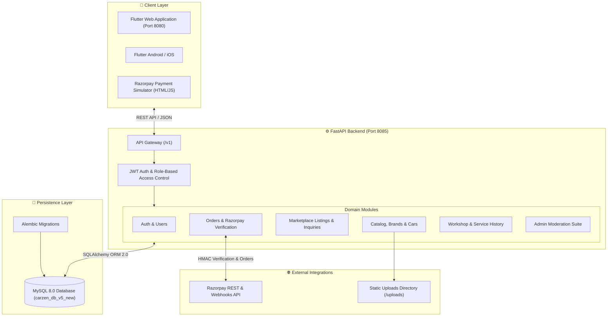

# 🚗 CarZen - Complete Automotive Marketplace & Workshop Platform

[](https://fastapi.tiangolo.com)
[](https://www.python.org/)
[](https://flutter.dev/)
[](https://dart.dev/)
[](https://www.sqlalchemy.org/)
[](https://www.mysql.com/)
[](https://razorpay.com/)
[](LICENSE)

**CarZen** is a modern, enterprise-ready full-stack automotive platform designed to connect **car buyers, sellers, workshop service technicians, and administrators**. It unifies peer-to-peer vehicle commerce, an intelligent vehicle catalog and inventory manager, a full-lifecycle digital workshop service & booking system, and a tamper-proof Razorpay payment gateway into a seamless digital ecosystem.

Built with a decoupled, high-performance architecture:
- **Backend**: Asynchronous **FastAPI**, **SQLAlchemy 2.0 (ORM)**, and **MySQL 8.0** delivering 170+ production-tested REST endpoints.
- **Frontend**: Cross-platform **Flutter** client ([CarZen_UI_Flutter](CarZen_UI_Flutter)) supporting Web, Android, iOS, and Desktop with responsive UI, live search filters, and integrated Razorpay Web Checkout.

---

## 📑 Quick Navigation & Documentation

- 📖 **[Full REST API Documentation (172 Endpoints)](CarZen_Backend_Python/docs/API_DOCUMENTATION.md)** — Exhaustive endpoint reference with request/response schemas, parameter validations, and sample cURL commands.
- 💳 **[Payment Integration & Testing Guide](CarZen_Backend_Python/docs/PAYMENT_INTEGRATION_AND_TESTING_GUIDE.md)** — Step-by-step verification manual for Razorpay online checkout, webhook handlers, and offline cash settlements.
- ⚡ **Interactive Swagger UI**: [`http://localhost:8085/docs`](http://localhost:8085/docs) *(when backend server is running)*
- 📚 **ReDoc Alternative Docs**: [`http://localhost:8085/redoc`](http://localhost:8085/redoc)

---

## 🌟 Key Capabilities & Modules

### 1. 🚗 Vehicle Catalog & Inventory Management
- **Hierarchical Master Catalog**: Normalized Brands, Models, and Variants with detailed technical specifications (fuel type, transmission, horsepower, engine CC, seating capacity).
- **Seller Inventory**: Register vehicles with VIN, registration numbers, odometer readings, and condition (`new`, `oldCar`, `excellent`, `good`, `poor`).
- **High-Definition Gallery**: Upload multi-photo galleries, designate primary showcase images, and reorder assets.
- **Admin Moderation & Lifecycle**: Full status state machine (`draft` → `pending_approval` → `approved` / `rejected` → `published` → `sold`).

### 2. 🛒 Marketplace & Public Discovery
- **Public Vehicle Listings**: Search and filter vehicles by keyword, price range, brand, fuel type, transmission, and body style.
- **Detailed Showcase**: High-res gallery sliders, technical specifications, seller profile badges, and verified buyer reviews.
- **Buyer Wishlist**: One-tap bookmarking to track favorite vehicles.
- **Seller Publishing**: Instant publishing, pause, price adjustments, or delisting directly from the seller portal.

### 3. 💬 Inquiries & Negotiation Engine
- **Direct Offers & Inquiries**: Prospective buyers can submit purchase inquiries, customized price offers, and questions.
- **Threaded Messaging**: Real-time conversation thread between buyer and seller per vehicle listing.
- **Inquiry States**: Systematic lifecycle tracking through `PENDING`, `RESPONDED`, and `CLOSED`.

### 4. 💳 Orders & Razorpay Financial Engine
- **Dual Payment Modes**:
  - **Online**: Integrated Razorpay payment orders with server-side HMAC SHA-256 signature verification.
  - **Offline**: Cash on Handover / Delivery with seller or admin settlement confirmation.
- **Automated State Synchronization**: Once payment succeeds, the Order marks as `PAID`, the Listing automatically marks as `SOLD`, and a financial ledger row is logged.
- **Razorpay Web Checkout**: Native modal checkout inside Flutter Web via Razorpay JS SDK.
- **Webhooks**: Resilient webhook listeners for asynchronous order updates.

### 5. 🔧 Digital Workshop & Service Center
- **Service Catalog**: Browse standard maintenance packages, brake overhauls, AC sanitization, and diagnostics with transparent pricing.
- **Slot Booking**: Real-time calendar slot reservation preventing double-bookings.
- **End-to-End Service Lifecycle**:
  $$\text{PENDING} \longrightarrow \text{SCHEDULED} \longrightarrow \text{IN\_PROGRESS} \longrightarrow \text{COMPLETED}$$
- **Digital Service Booklet**: Odometer readings, replaced parts, technician remarks, and itemized billing automatically bound to the car's permanent history.
- **Online Service Payments**: Pay workshop bills directly through Razorpay before or upon vehicle collection.

### 6. 🛡️ Comprehensive Admin & Governance Portal
- **Platform Analytics**: High-level platform statistics for revenue, active users, listings volume, and workshop job metrics.
- **Vehicle & Listing Moderation**: Single-click review, approval, or rejection (with recorded reason) of seller cars.
- **Workshop Queue**: Dispatch jobs to technicians, update live service stages, and record completion details.
- **User Governance**: Inspect accounts, assign roles (`USER` vs `ADMIN`), and manage account statuses (`ACTIVE`, `INACTIVE`, `BLOCKED`).

---

## 🏛️ System Architecture



---

## 📂 Project Directory Structure

```
CarZen/
├── CarZen_UI_Flutter/                    # Cross-platform Flutter Frontend
│   ├── lib/
│   │   ├── config/api_config.dart        # API gateway endpoints & environments
│   │   ├── models/                       # Dart models (Car, Order, Service, User)
│   │   ├── providers/                    # State management (Auth, Car, Order)
│   │   ├── screens/                      # UI pages (Marketplace, Detail, Admin, Service)
│   │   ├── services/                     # HTTP API client services & Razorpay JS bridge
│   │   └── widgets/                      # Reusable UI components & cards
│   ├── web/                              # Web host with Razorpay Checkout SDK
│   ├── assets/                           # Application logos, branding, and images
│   ├── pubspec.yaml                      # Flutter dependencies & assets config
│   └── .gitignore                        # Flutter build & cache exclusions
│
├── CarZen_Backend_Python/                # Backend Repository Folder
│   ├── backend/                          # FastAPI Python Application
│   │   ├── app/                          # Core, API routers, ORM models, Pydantic schemas
│   │   │   ├── api/v1/                   # REST API route controllers
│   │   │   │   ├── admin/                # Admin moderation, orders, services
│   │   │   │   ├── auth/                 # JWT login, registration, token refresh
│   │   │   │   ├── buyer/                # Buyer marketplace, inquiries, orders
│   │   │   │   ├── car_management/       # Cars, brands, models, variants
│   │   │   │   ├── order/                # Purchase orders & checkout
│   │   │   │   ├── payment/              # Razorpay order generation & HMAC verify
│   │   │   │   ├── services/             # Workshop catalog & appointment bookings
│   │   │   │   └── users/                # Profiles & password management
│   │   │   ├── core/                     # Security, JWT signing, RBAC dependencies
│   │   │   ├── database/                 # SQLAlchemy connection pool & session handlers
│   │   │   ├── models/                   # SQLAlchemy ORM models & database Enums
│   │   │   ├── schemas/                  # Pydantic v2 validation & response models
│   │   │   ├── services/                 # Business logic & repository services
│   │   │   └── main.py                   # FastAPI application entry & CORS middleware
│   │   ├── uploads/                      # Uploaded vehicle photos and media files
│   │   ├── paymentCheck/                 # Standalone Razorpay test checkout page
│   │   │   └── index.html                # Browser payment simulator
│   │   ├── scripts/                      # Developer & maintenance utilities
│   │   │   ├── build_docs.py             # Introspects FastAPI routes to update docs
│   │   │   ├── live_chrome_test_suite.py # Automated Chrome CDP end-to-end smoke tester
│   │   │   ├── migrate_car_management.py # Schema migration for car lifecycle columns
│   │   │   └── seed_demo_listings.py     # Demo data seeder
│   │   ├── alembic/                      # Database migration revisions
│   │   ├── requirements.txt              # Production Python dependencies
│   │   ├── run.py                        # Server entrypoint (Runs on port 8085)
│   │   ├── .env.example                  # Environment configuration template
│   │   └── .gitignore                    # Python, bytecode, and virtualenv gitignore
│   └── docs/                             # Backend documentation
│       ├── API_DOCUMENTATION.md          # Complete 172-endpoint REST API reference
│       └── PAYMENT_INTEGRATION_AND_TESTING_GUIDE.md # Payment flows & verification guide
│
├── carzen_db_v5_new.sql                  # Production-ready MySQL dump (28 tables + seed data)
├── passwords.txt                         # Seeded test user credentials
├── reference.txt                         # Domain reference benchmarks
├── README.md                             # Main repository guide (this file)
└── LICENSE                               # MIT License
```

---

## 🔑 Pre-Seeded Demo Accounts

The included database dump ([carzen_db_v5_new.sql](carzen_db_v5_new.sql)) comes pre-populated with verified test accounts:

| Email | Password | Role | Account Status | Typical Use Case |
| :--- | :--- | :--- | :--- | :--- |
| `admin@gmail.com` | `Demo@1234` | **ADMIN** | `ACTIVE` | Vehicle approvals, moderation, workshop queue |
| `rahul.patel@gmail.com` | `Demo@1234` | **USER** | `ACTIVE` | Car owner / Seller with active vehicle listings |
| `ajay.mehta@gmail.com` | `Demo@1234` | **USER** | `ACTIVE` | Buyer placing orders & booking services |
| `nikhil.patel@gmail.com` | `Demo@1234` | **USER** | `ACTIVE` | Verified buyer with order history |
| `vishal@gmail.com` | `Vishal@123` | **USER** | `ACTIVE` | Primary developer sandbox account |

---

## 🚀 Getting Started & Installation

### Prerequisites
- **Python 3.10+** (Python 3.12 recommended)
- **Flutter SDK 3.24+** (with Chrome enabled for web)
- **MySQL 8.0+** running on `localhost:3306`
- **Git**

---

### Step 1: Set Up MySQL Database

1. Open your MySQL client (MySQL Workbench, DBeaver, or terminal):
   ```sql
   CREATE DATABASE IF NOT EXISTS carzen_db_v5_new CHARACTER SET utf8mb4 COLLATE utf8mb4_unicode_ci;
   ```
2. Import the clean, production-verified database dump:
   ```bash
   mysql -u root -p carzen_db_v5_new < carzen_db_v5_new.sql
   ```
   *(This creates all 28 tables, relationships, vehicle catalog, and pre-seeded demo users).*

---

### Step 2: Configure & Start the Backend

1. **Navigate to the backend directory**:
   ```bash
   cd CarZen_Backend_Python/backend
   ```

2. **Create and activate a virtual environment**:
   ```bash
   # Windows (PowerShell)
   python -m venv .venv
   .\.venv\Scripts\Activate.ps1

   # macOS / Linux
   python3 -m venv .venv
   source .venv/bin/activate
   ```

3. **Install dependencies**:
   ```bash
   pip install --upgrade pip
   pip install -r requirements.txt
   ```

4. **Set up `.env`**:
   Copy `.env.example` to `.env` (or verify existing `.env`):
   ```ini
   DATABASE_HOST="localhost"
   DATABASE_PORT=3306
   DATABASE_NAME="carzen_db_v5_new"
   DATABASE_USER="root"
   DATABASE_PASSWORD="your_mysql_password"
   PORT=8085
   CORS_ORIGINS="http://localhost:3000,http://127.0.0.1:8080,http://localhost:8080,http://127.0.0.1:8085,http://localhost:8085,*"

   SECRET_KEY="supersecretkey"
   ALGORITHM="HS256"
   ACCESS_TOKEN_EXPIRE_MINUTES=1440

   RAZORPAY_KEY_ID="rzp_test_key_ID"
   RAZORPAY_KEY_SECRET="your_razorpay_secret"
   RAZORPAY_WEBHOOK_SECRET="your_webhook_secret"
   RAZORPAY_MAX_ORDER_AMOUNT_PAISE=5000000
   ```

5. **Start the backend server**:
   ```bash
   python run.py
   ```
   The backend will start at: **`http://localhost:8085`**
   - Interactive Swagger API Explorer: **`http://localhost:8085/docs`**
   - ReDoc Documentation: **`http://localhost:8085/redoc`**

---

### Step 3: Configure & Start the Flutter Frontend

1. **Navigate to the Flutter project**:
   ```bash
   cd ../../CarZen_UI_Flutter
   ```

2. **Fetch packages**:
   ```bash
   flutter pub get
   ```

3. **Run on Flutter Web**:
   ```bash
   flutter run -d chrome --web-port=8080
   ```
   The application will launch in Chrome at: **`http://localhost:8080`**

   > [!TIP]
   > The Flutter client is configured to automatically communicate with `http://127.0.0.1:8085` for Web/Desktop and `http://10.0.2.2:8085` for Android Emulators.

---

## 🛠️ Developer & Testing Tools

### 1. Standalone Razorpay Payment Simulator
Test online payments without opening the full Flutter UI:
1. Ensure the backend is running on port 8085.
2. Open [`CarZen_Backend_Python/backend/paymentCheck/index.html`](CarZen_Backend_Python/backend/paymentCheck/index.html) directly in any browser.
3. Paste a created Razorpay Order ID and test checkout interactions with Razorpay test credentials.

### 2. Automated Live Chrome E2E Smoke Tester
Run an automated end-to-end browser test that navigates marketplace listings, checks authentication, inspects the admin portal, and tests car detail views with an on-screen HUD badge:
```bash
python CarZen_Backend_Python/backend/scripts/live_chrome_test_suite.py
```

### 3. Automated REST API Docs Generator
Regenerate [API_DOCUMENTATION.md](CarZen_Backend_Python/docs/API_DOCUMENTATION.md) directly from FastAPI’s live OpenAPI schema:
```bash
python CarZen_Backend_Python/backend/scripts/build_docs.py
```

---

## 🔒 Authentication & API Usage Example

CarZen utilizes OAuth2 Bearer Tokens (JWT).

### 1. Authenticate (Login)
```bash
curl -X POST "http://localhost:8085/v1/auth/login" \
  -H "Content-Type: application/json" \
  -d '{
    "email": "admin@gmail.com",
    "password": "Demo@1234"
  }'
```

**Response**:
```json
{
  "access_token": "eyJhbGciOiJIUzI1NiIsInR5cCI6IkpXVCJ9...",
  "token_type": "bearer"
}
```

### 2. Query Protected Endpoints
Include the token in the `Authorization` header:
```bash
curl -X GET "http://localhost:8085/v1/users/me" \
  -H "Authorization: Bearer <access_token>"
```

---

## 📄 License

This project is licensed under the MIT License — see the [LICENSE](LICENSE) file for details.